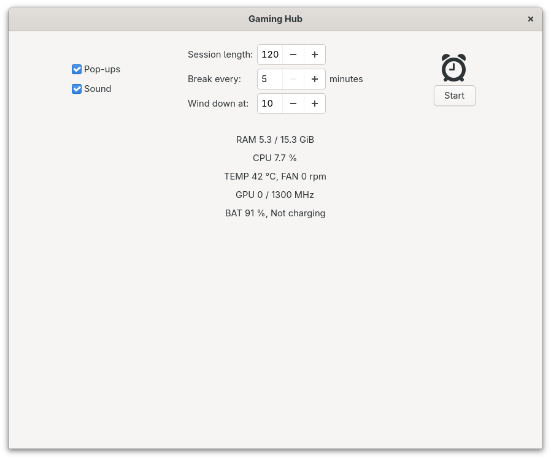
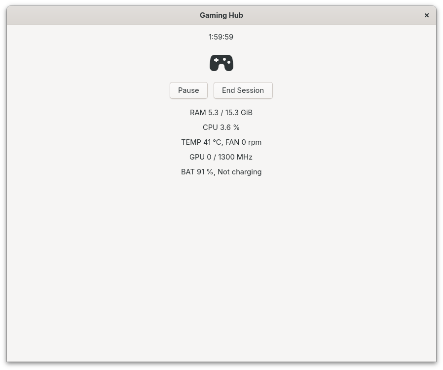
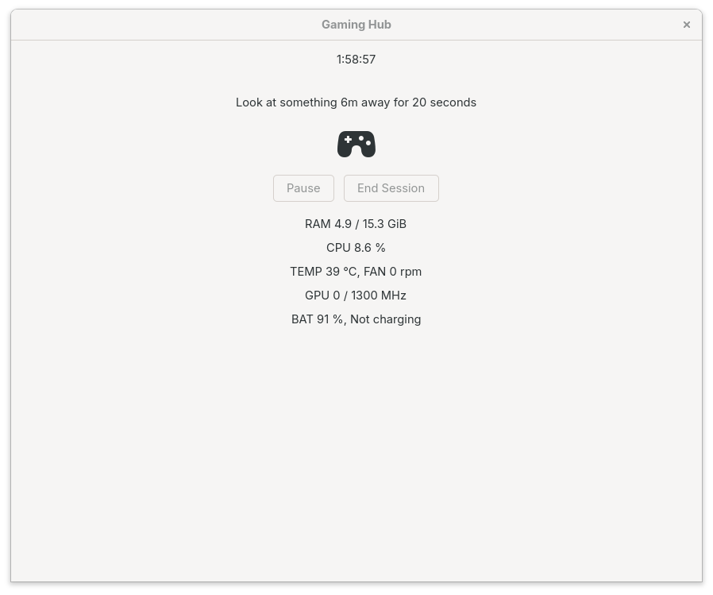
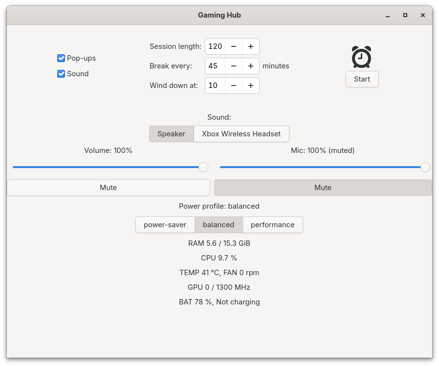

# Gaming_Hub - a program by TomSwb

## Description

#### Goal:

A small GTK4 window for my laptop screen while I game on the TV or projector. It opens when a game starts, shows what I care about during a session (system stats, headset, break timer, power), and acts as the break reminder of my Healthy Gaming Charter.

It is also a learning project: event-driven programming in C with GTK4, GLib/GObject, D-Bus and libpulse, all new to me.

> 🚧 **Work in progress.** Milestone 0 (research) and milestone 1 (the first window) done on 8 Nov 2026, milestone 2 (live stats) on 10 Nov: the window shows **RAM**, **CPU %**, **CPU temperature and fan**, **GPU frequency** and **battery / charger**, updated every second, at no measurable fps cost. Milestone 3 (the timer and healthy-gaming features) done on 19 Nov: session plan, countdown, Pause and End session, break screen, 20-20-20 eye cue, notifications and a bell, all values from a settings file and the plan page. Milestone 4 (auto-start and install) done on 20 Nov: `make install` puts the hub in the app menu, and through GameMode it opens when a game starts, shows a "Between Games" page when one closes (the session's countdown keeps running) and carries on when the next one starts. Milestone 5 (headset) done on 22 Nov: the Xbox Wireless Headset's volume and mic, each with a slider and a Mute button, kept in sync with GNOME's menu and the volume keys, and following the headset when it's turned off and on. Milestone 6 (power and sound) done on 22 Nov: the power profile is shown and switched with three buttons (in sync with GNOME), alerts when the charger comes out or the battery reaches 25 % during a session, and a **Sound** section that follows what I'm listening on (headset, speakers or projector): a button per output to switch it, the mic moving with it, the volume and mic sliders on the current devices, and a Bluetooth headset's battery beside the title. Now: milestone 7, the game library (step 1, the look by hand, done 22 Nov; steps 2–5 done 23 Nov: the game object, the library page, a KeyValues parser, and my 41 Steam games read from Steam's own files; see [`docs/library.md`](docs/library.md)), and the styling step when the palette arrives.

**Milestone 2 (10 Nov):** the first working prototype, every stat live and refreshed once a second.


**Milestone 3 (19 Nov):** the timer. Plan a session, play with a countdown, get a break screen, a 20-20-20 eye cue, and notifications with a bell; the stats stay under every page.

| Plan | Playing | Eye cue | Break |
| --- | --- | --- | --- |
|  |  |  |  |

**Milestones 5–6 (22 Nov):** the Sound section (output buttons, volume and mic of the current devices) and the power profile buttons.



#### Brief overview:

The window is snapped to one half of the laptop screen (Super+Left/Right), next to the YouTube Music app on the other half.

| Panel | Shows / does | Data source |
| --- | --- | --- |
| Stats | CPU % and frequency, GPU frequency and busy %, temperatures, RAM, battery and charger | `/proc`, `/sys/class/drm`, `/sys/class/hwmon`, `/sys/class/power_supply` |
| Sound | Volume and mute of the output and the mic (milestone 5); a button per output to switch what I'm listening on, the mic following it, a Bluetooth headset's battery (milestone 6) | PipeWire through libpulse; battery from BlueZ over D-Bus |
| Timer | Session plan, breaks, wind-down warning, 20-20-20 eye cue, pause button | GLib timers, GtkMediaFile, GNotification |
| Power | Power Saver / Balanced / Performance buttons; alerts when unplugged or at 25 % during a session | power-profiles D-Bus API (tuned-ppd); charger and battery from `/sys` |
| Session log | Silent: game, date and play time of library games, for the library's play history (milestone 7) | Own code, `~/.local/share/gaming_hub/` |
| Library | All my games (Steam, GOG/Epic through Heroic, emulators) in one list, started from the hub | Steam `appmanifest_*.acf`, Heroic's library JSON, ROM folders |
| Temp graph | Temperature over the whole session | GtkDrawingArea + Cairo |
| FPS (stretch) | Frame rate and frame time | MangoHud's log, if it can be read live |

**Starts and stops by itself:** every game launches through `gamemoderun`, and GameMode's `[custom] start=` / `end=` hooks run the hub. It is single-instance (GtkApplication), so the end hook just tells the running window to close the session. Emulators get `gamemoderun` added once to their app shortcut, so they open the hub too.

**Rule: the hub must not cost fps.** Iris Xe shares one power budget between CPU and GPU, so the hub refreshes once a second, redraws only what changed and has no animations. Checked at milestone 2 and at the end.

Code layout and how each part works: see [Documentation](#documentation).

## Instructions

Linux with GTK4's development package (and, from milestone 5, the PulseAudio client library; PipeWire speaks its API):

```bash
# Fedora
sudo dnf install gtk4-devel pulseaudio-libs-devel
# Debian / Ubuntu
sudo apt install libgtk-4-dev libpulse-dev

make
./gaming_hub
```

**Install** (for your user only, no root): `make install` builds the hub, copies it to `~/.local/bin/gaming_hub` and writes `~/.local/share/applications/ch.bitminded.GamingHub.desktop`, so the hub is in the app menu and can be started as `gaming_hub`. `make uninstall` removes exactly those two files. Another location: `make install PREFIX=/some/where`. A running GNOME may keep showing an older menu entry until you log out and back in.

**Command line:**

| Command | What it does |
| --- | --- |
| `gaming_hub` | opens the hub, or brings the open one to the front (one instance only) |
| `gaming_hub --start` | a game started: opens the hub (on the plan page) or brings it forward; a session that is between games carries on |
| `gaming_hub --end` | a game closed: a running session goes to the "Between Games" page, its countdown keeps running; opens nothing if the hub isn't running |
| `gaming_hub --help` | lists the options |

The Makefile gets GTK's compiler and linker flags from `pkg-config`, so it builds on any distribution without editing paths.

**Editor support:** `make` also writes `compile_flags.txt` (one flag per line, from the same `pkg-config` output) so clangd finds GTK's headers. It is generated for each machine and not tracked in git.

**Settings (optional):** the timer works with built-in defaults. To change them, create `~/.config/gaming_hub/settings.ini`; any key you leave out keeps its default:

```ini
# Gaming Hub timer settings
[timer]
session_minutes=120
wind_down_minutes=10
break_every_minutes=50
eye_every_minutes=20
eye_seconds=20
popups=true
sound=true
```

The file is read when the window opens; no rebuild needed. It only decides what the plan page shows at first: session length, break interval, wind-down and the two checkboxes can be changed there for each session. Numbers must be whole numbers above 0; `popups` and `sound` take `true` or `false`, **lowercase** (`TRUE` is an invalid value for GLib). A missing, broken or invalid key gives one line on the terminal and its default is used.

**Headset:** the hub looks for the sound output and mic whose description is exactly `Xbox Wireless Headset` (`HUB_HEADSET_NAME` in `includes/defaults.h`). For another headset, put the name `pactl list sinks | grep Description` shows for it there and rebuild. Without it (or with no sound server), the headset section says "No device found" and its controls stay greyed out. After pulling a new version, run `make install` again so the installed copy is up to date.

**Notifications need the `.desktop` file** that `make install` writes: GNOME only shows notifications from apps it can match to a `.desktop` file named after the app id, so a hub run from the repo without installing shows none. With Do Not Disturb on, GNOME shows no banners at all (they go to the message list); the bell still rings.

Packaging (Flatpak or RPM) is a later idea.

## Hook it to your games

The hub opens and follows your games through [GameMode](https://github.com/FeralInteractive/gamemode) (`sudo dnf install gamemode` on Fedora, `sudo apt install gamemode` on Debian / Ubuntu). GameMode switches on when a game started through `gamemoderun` runs, and can run a command when the first game starts and when the last one closes.

**1. Install the hub** with `make install` (see above), so GameMode finds it as `gaming_hub`. Check that GameMode's service sees `~/.local/bin`: `systemctl --user show-environment | grep '^PATH='`; if it doesn't, use the full path `~/.local/bin/gaming_hub` (written out, e.g. `/home/you/.local/bin/gaming_hub`) in the lines below.

**2. Add the two lines** to `~/.config/gamemode.ini` (create the file if it doesn't exist):

```ini
[custom]
start=gaming_hub --start > /dev/null 2>&1 &
end=gaming_hub --end
```

Copy the `start=` line exactly: GameMode waits for its commands (and kills them after 10 s), so the hub must go to the background (`&`) **and** give back GameMode's output (`> /dev/null 2>&1`), or every game starts 10 seconds late and the hub is closed. Why: [`docs/auto-start.md`](docs/auto-start.md), step 3.

**3. Start your games through GameMode:**

| Launcher | How |
| --- | --- |
| Steam | per game: Properties → General → Launch options: `gamemoderun %command%` (with MangoHud: `mangohud gamemoderun %command%`). Steam has no setting for all games at once. |
| Heroic (GOG, Epic) | per game: its settings, the GameMode switch |
| Lutris | the "Enable Feral GameMode" switch in the system options |
| Emulators and other apps | copy the app's `.desktop` file into `~/.local/share/applications/` (same name: your copy overrides the system one, the system file stays untouched) and put `gamemoderun ` in front of its `Exec=` line. Flatpak apps' files are in `/var/lib/flatpak/exports/share/applications/` (or `~/.local/share/flatpak/exports/share/applications/`). Skip files with `DBusActivatable=true`: GNOME ignores their `Exec=` line. |

Tested on Fedora 44 with GameMode 1.8.2: Steam games, the Flatpaks of Dolphin, PrimeHack, PCSX2, PPSSPP, RetroArch, RMG and mGBA (`gamemoderun flatpak run …` works: GameMode switches on and off with the emulator), and the OpenGOAL launcher (an AppImage). With an emulator or a launcher, the "game" is the emulator: the hub sees it close when you quit the emulator, not a game inside it.

**What happens:**

| Moment | Hub |
| --- | --- |
| A game starts, hub not running | opens on the plan page |
| A game closes during a session | "Between Games" page; the session's countdown keeps running |
| The next game starts | back to the playing page, same session |
| End session, or the planned time is up | the session ends |

On Wayland an app can't choose its screen: GNOME opens the hub where the pointer or the focused window is. Move it with Super+Shift+←/→, snap it with Super+←/→.

## Milestones

Each one is usable on its own. Full plan: [`docs/gaming-hub/game-dashboard.md`](https://github.com/TomSwb/set_up/blob/main/docs/gaming-hub/game-dashboard.md) in my set_up repo.

- [x] 0. Research (no code): headset battery, MangoHud logging (8 Nov, see `docs/research.md`)
- [x] 1. Hello window: GtkApplication, main loop, signals, GObject basics (8 Nov)
- [x] 2. Live stats from `/proc` and `/sys` + fps-cost check (8–10 Nov)
- [x] 3. Timer and healthy-gaming features, settings file (10–19 Nov)
- [x] 4. Auto-start with GameMode, single instance, `--start` / `--end`, between games; `make install` (app menu entry) and a guide to hook it to Steam, Heroic, Lutris and emulators (20 Nov)
- [x] 5. Headset volume and mic with libpulse: sliders and Mute for both, in sync with GNOME, follows the headset off / on (21–22 Nov)
- [x] 6. Power profile over D-Bus, battery alerts, the Sound section (output buttons, sliders on the default devices, headset battery from BlueZ) (22 Nov)
- [ ] 7. Game library + launcher: Steam, GOG/Epic (Heroic) and emulator games in one list, started from the hub
- [ ] 8. Temperature graph with Cairo
- [ ] 9. FPS from MangoHud (stretch)

Dropped 20 Nov 2026: the old milestone 7 (session log, game notes, stop ritual, monthly review); only a silent session log for the library's play history stays, inside milestone 7. The milestones after it were renumbered (old 8–10 are now 7–9; commits and docs before 20 Nov use the old numbers).

## Documentation

| File | What it covers |
| --- | --- |
| [`docs/files.md`](docs/files.md) | What each source file, header and folder does |
| [`docs/research.md`](docs/research.md) | Milestone 0: what I tested by hand before coding (headset battery, MangoHud) |
| [`docs/basics.md`](docs/basics.md) | Milestone 1: app id, how the program runs (main loop, callbacks), who frees what |
| [`docs/live-stats.md`](docs/live-stats.md) | Milestone 2: the tick, reading `/proc` and `/sys`, finding devices by name, fps-cost check |
| [`docs/timer.md`](docs/timer.md) | Milestone 3: settings file, countdown and states, pages, eye cue, notifications, plan page |
| [`docs/auto-start.md`](docs/auto-start.md) | Milestone 4: single instance, `--start` / `--end`, starting with GameMode, `make install`, between games, emulators |
| [`docs/headset.md`](docs/headset.md) | Milestone 5: how PipeWire shows the headset, libpulse in the main loop, finding the headset, sliders and Mute, events, no echo |
| [`docs/power.md`](docs/power.md) | Milestone 6, steps 1–4: tuned-ppd and UPower by hand, the `GDBusProxy`, profile buttons and `Properties.Set`, battery alerts |
| [`docs/bluez.md`](docs/bluez.md) | Milestone 6, step 5: the headset line, BlueZ's object manager, the default output's Bluetooth address from libpulse |
| [`docs/sound.md`](docs/sound.md) | Milestone 6, steps 6–7: sliders on the default output and input, output buttons, the mic following, rebuilding when devices come and go |
| [`docs/library.md`](docs/library.md) | Milestone 7: the steps, and what I found by hand (Steam's library files, my dumps' names and disc headers, where the covers are, emulator flags) |

## Resources

#### Docs:

* [GTK4](https://docs.gtk.org/gtk4/), [GLib](https://docs.gtk.org/glib/), [GIO](https://docs.gtk.org/gio/) (GApplication, GDBus, GNotification)
* [libpulse API](https://freedesktop.org/software/pulseaudio/doxygen/)
* [power-profiles-daemon D-Bus API](https://gitlab.freedesktop.org/upower/power-profiles-daemon), [UPower](https://upower.freedesktop.org/docs/)
* [MangoHud](https://github.com/flightlessmango/MangoHud) (logging options)
* `man 5 proc`, kernel docs for `/sys/class/hwmon` and `/sys/class/power_supply`

#### Editor:

* `VSCodium`: Used to avoid Microsoft telemetry and AI-integrated temptations.

### AI:

⚠️ Disclaimer: I only ask for actual answers/solutions when I realise that I am missing theoretical knowledge.

e.g.: a new syntax or a new concept I had not explored previously.

I always write my code to the best of my abilities first.

My AI agents are set to guide me with questions as per the 42 pedagogical philosophy.

I use VSCodium on purpose to not have AI integration. This means that, except for my copy-pastes into chats for some reviews, AI does not see my code, and AI will never write my code - I do not copy-paste from AI into my code.

`Claude:`

1. Teacher: explains the new concepts of each milestone (GTK4, GLib, GObject, D-Bus, libpulse) and points me to the docs, with hints and small examples on other cases, never finished code.
2. Peer reviewer: reviews the code I paste like a 42 correction (bugs, leaks, GObject references, error handling) and asks questions that lead me to the fix.
3. Documentation: writes and keeps up to date this README and the plan in my set_up repo. The code is all mine.

`History:` on 19 Nov 2026 the commit messages were reworded with Claude into one consistent style (`Area: Do something`). Only the messages changed: the code, authors and dates of every commit are the originals.
