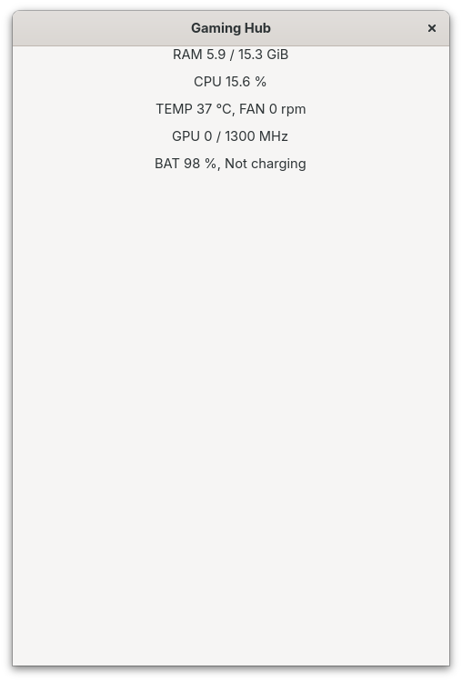

# Gaming_Hub - a program by TomSwb

## Description

#### Goal:

A small GTK4 window for my laptop screen while I game on the TV or projector. It opens when a game starts, shows what I care about during a session (system stats, headset, break timer, power), keeps a log of my sessions, and acts as the break reminder of my Healthy Gaming Charter.

It is also a learning project: event-driven programming in C with GTK4, GLib/GObject, D-Bus and libpulse, all new to me.

> 🚧 **Work in progress.** Milestone 0 (research) and milestone 1 (the first window) done on 8 Nov 2026, milestone 2 (live stats) on 10 Nov: the window shows **RAM**, **CPU %**, **CPU temperature and fan**, **GPU frequency** and **battery / charger**, updated every second, at no measurable fps cost. Next: milestone 3, the timer and healthy-gaming features.

**Milestone 2 (10 Nov):** the first working prototype, every stat live and refreshed once a second.



#### Brief overview:

The window is snapped to one half of the laptop screen (Super+Left/Right), next to the YouTube Music app on the other half.

| Panel | Shows / does | Data source |
| --- | --- | --- |
| Stats | CPU % and frequency, GPU frequency and busy %, temperatures, RAM, battery and charger | `/proc`, `/sys/class/drm`, `/sys/class/hwmon`, `/sys/class/power_supply` |
| Headset | Volume, mute, mic volume and mute, battery (if Linux can read it) | PipeWire through libpulse; battery TBD in milestone 0 |
| Timer | Session plan, breaks, wind-down warning, 20-20-20 eye cue, pause button | GLib timers, GtkMediaFile, GNotification |
| Power | Balanced ↔ Performance switch, charger warning | power-profiles D-Bus API (tuned-ppd), UPower |
| Session log | Game (detected, then confirmed by me at the end), start/end, play time, average fps, max temperature → CSV | Own code, `~/.local/share/gaming_hub/` |
| Game notes | Per-game card: settings that worked, "where I was / what's next" | Text files per game |
| Library | All my games (Steam, GOG/Epic through Heroic, emulators) in one list, started from the hub | Steam `appmanifest_*.acf`, Heroic's library JSON, ROM folders |
| Temp graph | Temperature over the whole session | GtkDrawingArea + Cairo |
| FPS (stretch) | Frame rate and frame time | MangoHud's log, if it can be read live |

**Starts and stops by itself:** every game launches through `gamemoderun`, and GameMode's `[custom] start=` / `end=` hooks run the hub. It is single-instance (GtkApplication), so the end hook just tells the running window to close the session. Emulators get `gamemoderun` added once to their app shortcut, so they open the hub too.

**Rule: the hub must not cost fps.** Iris Xe shares one power budget between CPU and GPU, so the hub refreshes once a second, redraws only what changed and has no animations. Checked at milestone 2 and at the end.

`Files:`

* `main.c`: creates the application (`ch.bitminded.GamingHub`) and the hub's state struct, runs GTK's main loop, builds the window when the app is activated, starts the once-a-second timer (`hub_tick`), frees the struct's strings when the app ends
* `sources/utils.c`: the state struct's life: `hub_struct_init` (every field to a known value), `hub_setting_hub` (labels + finding the sensor folders, once), `hub_build_box` (the window's layout), `hub_free_hub` (frees what the struct owns)
* `sources/sysfs.c`: shared readers for `/sys`: `hub_find_dir` (finds a device folder by the content of one of its files, e.g. hwmon `name` = `coretemp`), `hub_find_gpu` (the DRM card that has `gt_act_freq_mhz`), `hub_read_number` and `hub_read_text` (one value from a one-value file)
* `sources/ram.c`: reads `/proc/meminfo`, shows used / total RAM
* `sources/cpu.c`: reads `/proc/stat`, shows CPU % from two samples one second apart
* `sources/temp_fan.c`: CPU package temperature (`coretemp`) and fan speed (`thinkpad`) on one line
* `sources/gpu.c`: GPU frequency (actual / maximum), from `/sys/class/drm`
* `sources/battery.c`: battery % and status, with the charger as fallback
* `includes/gaming_hub.h`: shared header (the `t_hub` struct and every prototype)
* `Makefile`: builds the hub and libft, with GTK4's flags from `pkg-config`; also writes `compile_flags.txt` for the editor
* `docs/historic/`: screenshots of the hub at each stage (`first_working_prototype.png`, milestone 2)
* `docs/research.md`: what I tested by hand before coding (headset battery over D-Bus, MangoHud logging) and the rules the code must follow

`Additionally contains:`

* `libft/`: my 42 libft (with `ft_printf` and `get_next_line`)

## Instructions

Linux with GTK4's development package (and, from milestone 5, the PulseAudio client library; PipeWire speaks its API):

```bash
# Fedora
sudo dnf install gtk4-devel pulseaudio-libs-devel
# Debian / Ubuntu
sudo apt install libgtk-4-dev libpulse-dev

make
./gaming_hub
```

The Makefile gets GTK's compiler and linker flags from `pkg-config`, so it builds on any distribution without editing paths.

**Editor support:** `make` also writes `compile_flags.txt` (one flag per line, from the same `pkg-config` output) so clangd finds GTK's headers. It is generated for each machine and not tracked in git.

**Coming at milestone 4:** `make install` (app menu entry with an icon) and a guide to start the hub automatically with your games (Steam, Heroic, Lutris, emulators) through GameMode. Packaging (Flatpak or RPM) is a later idea.

## Milestones

Each one is usable on its own. Full plan: [`docs/game-dashboard.md`](https://github.com/TomSwb/set_up/blob/main/docs/game-dashboard.md) in my set_up repo.

- [x] 0. Research (no code): headset battery, MangoHud logging (8 Nov, see `docs/research.md`)
- [x] 1. Hello window: GtkApplication, main loop, signals, GObject basics (8 Nov)
- [x] 2. Live stats from `/proc` and `/sys` + fps-cost check (8–10 Nov)
- [ ] 3. Timer and healthy-gaming features, settings file
- [ ] 4. Auto-start with GameMode, single instance, `--end`; `make install` (app menu icon) and a guide to hook it to Steam, Heroic, Lutris and emulators
- [ ] 5. Headset volume and mic with libpulse
- [ ] 6. Power profile and charger over D-Bus
- [ ] 7. Session log, game notes, stop ritual, monthly review
- [ ] 8. Game library + launcher: Steam, GOG/Epic (Heroic) and emulator games in one list, started from the hub
- [ ] 9. Temperature graph with Cairo
- [ ] 10. FPS from MangoHud (stretch)

## Resources

#### Docs:

* [GTK4](https://docs.gtk.org/gtk4/), [GLib](https://docs.gtk.org/glib/), [GIO](https://docs.gtk.org/gio/) (GApplication, GDBus, GNotification)
* [libpulse API](https://freedesktop.org/software/pulseaudio/doxygen/)
* [power-profiles-daemon D-Bus API](https://gitlab.freedesktop.org/upower/power-profiles-daemon), [UPower](https://upower.freedesktop.org/docs/)
* [MangoHud](https://github.com/flightlessmango/MangoHud) (logging options)
* `man 5 proc`, kernel docs for `/sys/class/hwmon` and `/sys/class/power_supply`

#### Editor:

* `VSCodium`: Used to avoid Microsoft telemetry and AI-integrated temptations.

### AI:

⚠️ Disclaimer: I only ask for actual answers/solutions when I realise that I am missing theoretical knowledge.

e.g.: a new syntax or a new concept I had not explored previously.

I always write my code to the best of my abilities first.

My AI agents are set to guide me with questions as per the 42 pedagogical philosophy.

I use VSCodium on purpose to not have AI integration. This means that, except for my copy-pastes into chats for some reviews, AI does not see my code, and AI will never write my code - I do not copy-paste from AI into my code.

`Claude:`

1. Teacher: explains the new concepts of each milestone (GTK4, GLib, GObject, D-Bus, libpulse) and points me to the docs, with hints and small examples on other cases, never finished code.
2. Peer reviewer: reviews the code I paste like a 42 correction (bugs, leaks, GObject references, error handling) and asks questions that lead me to the fix.
3. Documentation: writes and keeps up to date this README and the plan in my set_up repo. The code is all mine.

## Detailed description:

### Application id

`ch.bitminded.GamingHub` (reverse of my domain `bitminded.ch`). It is only a name, nothing goes online: the system uses it to recognise the running app (single instance, milestone 4) and to name the `.desktop` file and the icon. **It never changes.** The window title, "Gaming Hub", can.

### How the program runs (milestone 1)

GTK programs are **event-driven**: `main` sets things up, then hands control to GTK's **main loop**, which sleeps until something happens and calls the functions that asked for it (callbacks).

```
main → gtk_application_new (the app object, with its id)
     → g_signal_connect(app, "activate", hub_activate)   only registers the callback
     → g_application_run → main loop starts → emits "activate" → hub_activate builds the window
                         → … waits for events …
                         → window closed → nothing holds the app → loop ends
     → g_object_unref(app) → return the exit status
```

`hub_activate` creates a `GtkApplicationWindow` (it belongs to the app and keeps it running while open), sets the title and a default size (480×720, a portrait panel; it is snapped to half the screen anyway), puts a `GtkLabel` in it and presents it. Setup first, `present` last.

### Who frees what

The docs of every function say who owns the returned object ("Return value"):

| Object | Owner | Freed by |
| --- | --- | --- |
| The app (`gtk_application_new`: "the caller takes ownership") | `main` | `g_object_unref(app)` at the end of `main` |
| The window (`gtk_application_window_new`: "owned by the called function") | GTK's list of windows | GTK, when the window is closed |
| The label (milestone 1, before the box) | the window (`gtk_window_set_child` takes its floating reference) | the window, when it is destroyed |
| The box and the stat labels (milestone 2) | the window owns the box, the box owns its labels (`gtk_box_append` takes the floating reference) | GTK, when the window is destroyed |
| The state struct `t_hub` (milestone 2) | `main` (a local variable) | nobody: it lives on `main`'s stack, and `main` is inside `g_application_run` for as long as the app runs |
| Strings from `g_file_get_contents`, `g_strdup_printf`, `g_strdup`, `g_build_filename` | the caller | `g_free`, on every path (a second pointer walks the text, only the first one is freed) |
| The sensor folder paths in `t_hub` (`temp_dir`, `fan_dir`, `gpu_dir`, `bat_dir`, `mains_dir`, milestone 2) | the struct, so `main` | `hub_free_hub` after `g_application_run` returns (`NULL` from `hub_struct_init` if never found: `g_free(NULL)` does nothing) |
| A `GDir` (`g_dir_open`) | the function that opened it | `g_dir_close` (not `g_free`, it isn't a GObject), in that same function, on every exit |
| Names from `g_dir_read_name` | the `GDir` (borrowed) | nobody: valid until the next read or `g_dir_close`, so the full path is built (an owned copy) before the folder is closed |
| Text from `hub_read_text` | the caller | `g_free`; `NULL` means it couldn't be read |
| Fixed texts (`"CPU ..."`) passed to `gtk_label_set_text` | nobody (string literals) | never freed: the label copies the text |

Never `free()` a GObject, never unref what you don't own. Each widget is stored as the type I call most on it (`GtkWindow *` for the window, `GtkWidget *` for the label), so casts like `GTK_WINDOW()` are rare.

### Live stats (milestone 2)

**The tick.** `hub_activate` starts a timer with `g_timeout_add_seconds(1, hub_tick, hub)`: the main loop calls `hub_tick` once a second, and `hub_tick` returns `G_SOURCE_CONTINUE` to be called again (`G_SOURCE_REMOVE` would stop it). `hub_activate` also calls `hub_tick` once itself, so the labels are filled at once instead of after one second. Once a second is the fps rule: an interval of 0 would call it nonstop and eat CPU.

**One pointer for everything.** A timer callback gets one `gpointer`, so all widgets and state live in one struct, `t_hub`, and the timer gets a pointer to it:

```
main: t_hub hub  ──&hub──▶  g_signal_connect(... "activate" ...)  ──▶  hub_activate(user_data)
                                                                          └─ g_timeout_add_seconds(1, hub_tick, hub) ──▶ hub_tick(user_data) every second
```

The struct lives in `main`, not in `hub_activate`: `hub_activate` returns right after building the window, so a local there would be gone (dangling pointer) when the first tick comes. `main` stays inside `g_application_run` until the app quits, so its locals live exactly as long as the app. A plain struct comes back from `gpointer` by assignment (`t_hub *hub = user_data;`); a GObject uses its check macro (`GTK_LABEL(...)`), which checks the type at run time.

**Layout.** A window has one child, so that child is a vertical `GtkBox`; each stat is a `GtkLabel` appended to it. `gtk_label_set_text` copies the text, and does nothing (no redraw) when the text hasn't changed: that is the "redraw only what changed" rule for free.

**Reading kernel files.** `/proc` and `/sys` files are text the kernel writes when you read them. `g_file_get_contents` reads one whole file into a new string (`contents`, `length` and the error are out-parameters; `NULL` for the error, because a failure every second must not spam: the label shows `...` instead). Values are found with pointers into that text, no copies: `ft_strnstr` for the key (with its colon, so `Active:` doesn't match `Active(anon):`), jump past the key, `g_ascii_strtoull` for the number. Its `endptr` says where it stopped: if it didn't move, there was no number; it is also where the next number starts.

**RAM** (`ram.c`): used = `MemTotal − MemAvailable`. `MemFree` is wrong for this: Linux fills spare RAM with file cache and drops it when a program needs memory; `MemAvailable` is the kernel's estimate of what a new program (the game) can get without swapping. Values are in KiB, shown in GiB (divide by `1024.0 * 1024.0`, the `.0` makes it a `double` division).

**CPU %** (`cpu.c`): the first line of `/proc/stat` holds counters, in 1/100 s, of time spent by all 8 threads since boot: user, nice, system, idle, iowait, irq, softirq, steal (guest columns skipped: already inside user/nice). A percentage needs two readings: CPU % = 100 × (Δtotal − Δidle) / Δtotal, with total = columns 1–8 and idle = idle + iowait. The struct keeps the previous reading (`prev_total`, `prev_idle`). First tick: nothing to compare with yet, so it stores the reading and shows `CPU -`. If Δtotal is 0 (two calls within 10 ms), it keeps the old text instead of dividing by zero. Check: one `yes > /dev/null` adds about 12.5 % (one thread of 8).

**Unknown values.** Every label has a failure text with `...` in place of the value (`RAM ... GiB`, `CPU ...`, `TEMP ... °C`, `GPU ... MHz`, `BAT ... %`), so the window never shows a stale or invented number. `CPU ...` also covers the first tick. A real `0` is different and is shown: the fan stopped at idle, the GPU asleep.

**Finding devices by name, not number.** `/sys/class/hwmon/hwmon8` today can be `hwmon7` after a reboot, and `card1` can be `card0`. So each device folder is found **once**, when the window is built, and kept in `t_hub` (state, like `prev_total`); the tick only reads one small file per value. `hub_find_dir(class_dir, file, value)` opens the class folder with `GDir`, builds `class_dir/entry/file` for each entry with `g_build_filename`, reads it, cuts the trailing `\n` (`g_strchomp`, the kernel ends these files with a newline) and compares it with `g_strcmp0` (0 = equal). It returns the folder path, or `NULL`. Used four times:

| Device | Class folder | File = value | Found here |
| --- | --- | --- | --- |
| CPU temperature | `/sys/class/hwmon` | `name` = `coretemp` | `hwmon8` |
| Fan | `/sys/class/hwmon` | `name` = `thinkpad` | `hwmon6` |
| Battery | `/sys/class/power_supply` | `type` = `Battery` | `BAT0` |
| Charger | `/sys/class/power_supply` | `type` = `Mains` | `AC` |

The GPU has no `name` file, and its connectors (`card1-eDP-1`, `card1-HDMI-A-1`, …) start with the same name, so `hub_find_gpu` takes the DRM entry that **contains** `gt_act_freq_mhz` (`g_file_test`).

**Temperature and fan** (`temp_fan.c`): `temp1_input` in the `coretemp` folder is "Package id 0", the whole chip, in millidegrees (`31000` = 31 °C, steps of 1 °C on this CPU), shown with `/ 1000.0` and `%.0f`. The Iris Xe GPU is on the same chip, so this covers it too. `fan1_input` in the `thinkpad` folder is in RPM. Each value is read once per tick and has its own `...`. The fan sits at 0 until the firmware wants it (one busy thread reached 65 °C with the fan still off); under `stress-ng --cpu 0`: short peak at the turbo start, then 60–70 °C, fan ~3800 RPM (baseline 6 Nov: 59–63 °C, ~3890 RPM).

**GPU** (`gpu.c`): `gt_act_freq_mhz` is what the GPU **actually** runs at; `gt_cur_freq_mhz` is only the driver's last request (350 while the GPU sleeps). Between frames the GPU switches off (RC6), so at the desktop or with a video (decoded by the separate media engine) it reads 0 with short peaks; in a game it stays high. The maximum comes from `gt_RP0_freq_mhz` (the hardware's highest, 1300 MHz here), read once, so the line is `GPU 1300 / 1300 MHz` at the limit and works on other GPUs.

**Battery** (`battery.c`): `capacity` (%) and `status` (`Charging`, `Discharging`, `Not charging`, `Full`) from the battery folder; `hub_read_text` returns the word. If `status` can't be read, the charger's `online` (1 = plugged in) gives `plugged in` / `on battery` instead. `Not charging` at 99 % is the ThinkPad protecting a full battery. No battery at all: `BAT ... %`.

**Formats.** `guint64` is printed with `"%" G_GUINT64_FORMAT` (a macro string glued to `"%"`), not `%lu`, which only happens to match on 64-bit Linux. A fixed text goes straight to `gtk_label_set_text` (it copies); `g_strdup_printf` only when values are formatted in.

**fps-cost check (10 Nov).** `glmark2` (fixed 3D scenes, one score), charger in, Balanced profile, screen lock held off with `gnome-session-inhibit --inhibit idle`: **3581 without the hub, 3546 with the hub open beside it (−1.0 %)**, inside normal run-to-run noise. A run where the screen locked scored 3943 (frames not displayed), so it didn't count. A real game test comes again at the end of the project.
