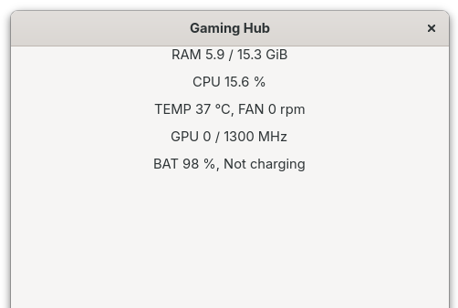
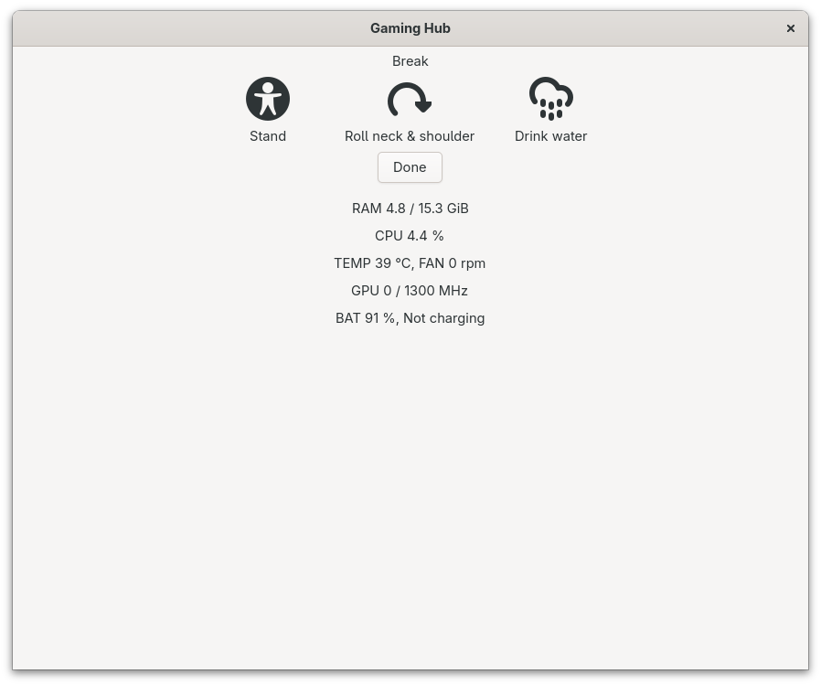

# Gaming_Hub - a program by TomSwb

## Description

#### Goal:

A small GTK4 window for my laptop screen while I game on the TV or projector. It opens when a game starts, shows what I care about during a session (system stats, headset, break timer, power), keeps a log of my sessions, and acts as the break reminder of my Healthy Gaming Charter.

It is also a learning project: event-driven programming in C with GTK4, GLib/GObject, D-Bus and libpulse, all new to me.

> 🚧 **Work in progress.** Milestone 0 (research) and milestone 1 (the first window) done on 8 Nov 2026, milestone 2 (live stats) on 10 Nov: the window shows **RAM**, **CPU %**, **CPU temperature and fan**, **GPU frequency** and **battery / charger**, updated every second, at no measurable fps cost. Milestone 3 (the timer and healthy-gaming features) done on 19 Nov: session plan, countdown, Pause and End session, break screen, 20-20-20 eye cue, notifications and a bell, all values from a settings file and the plan page. Next: milestone 4, auto-start with games and `make install`.

**Milestone 2 (10 Nov):** the first working prototype, every stat live and refreshed once a second.



**Milestone 3 (19 Nov):** the timer. Plan a session, play with a countdown, get a break screen, a 20-20-20 eye cue, and notifications with a bell; the stats stay under every page.

| Plan | Playing | Eye cue | Break |
| --- | --- | --- | --- |
|  |  |  |  |

#### Brief overview:

The window is snapped to one half of the laptop screen (Super+Left/Right), next to the YouTube Music app on the other half.

| Panel | Shows / does | Data source |
| --- | --- | --- |
| Stats | CPU % and frequency, GPU frequency and busy %, temperatures, RAM, battery and charger | `/proc`, `/sys/class/drm`, `/sys/class/hwmon`, `/sys/class/power_supply` |
| Headset | Volume, mute, mic volume and mute, battery (if Linux can read it) | PipeWire through libpulse; battery TBD in milestone 0 |
| Timer | Session plan, breaks, wind-down warning, 20-20-20 eye cue, pause button | GLib timers, GtkMediaFile, GNotification |
| Power | Balanced ↔ Performance switch, charger warning | power-profiles D-Bus API (tuned-ppd), UPower |
| Session log | Game (detected, then confirmed by me at the end), start/end, play time, average fps, max temperature → CSV | Own code, `~/.local/share/gaming_hub/` |
| Game notes | Per-game card: settings that worked, "where I was / what's next" | Text files per game |
| Library | All my games (Steam, GOG/Epic through Heroic, emulators) in one list, started from the hub | Steam `appmanifest_*.acf`, Heroic's library JSON, ROM folders |
| Temp graph | Temperature over the whole session | GtkDrawingArea + Cairo |
| FPS (stretch) | Frame rate and frame time | MangoHud's log, if it can be read live |

**Starts and stops by itself:** every game launches through `gamemoderun`, and GameMode's `[custom] start=` / `end=` hooks run the hub. It is single-instance (GtkApplication), so the end hook just tells the running window to close the session. Emulators get `gamemoderun` added once to their app shortcut, so they open the hub too.

**Rule: the hub must not cost fps.** Iris Xe shares one power budget between CPU and GPU, so the hub refreshes once a second, redraws only what changed and has no animations. Checked at milestone 2 and at the end.

Code layout and how each part works: see [Documentation](#documentation).

## Instructions

Linux with GTK4's development package (and, from milestone 5, the PulseAudio client library; PipeWire speaks its API):

```bash
# Fedora
sudo dnf install gtk4-devel pulseaudio-libs-devel
# Debian / Ubuntu
sudo apt install libgtk-4-dev libpulse-dev

make
./gaming_hub
```

**Install** (for your user only, no root): `make install` builds the hub, copies it to `~/.local/bin/gaming_hub` and writes `~/.local/share/applications/ch.bitminded.GamingHub.desktop`, so the hub is in the app menu and can be started as `gaming_hub`. `make uninstall` removes exactly those two files. Another location: `make install PREFIX=/some/where`. A running GNOME may keep showing an older menu entry until you log out and back in.

**Command line:**

| Command | What it does |
| --- | --- |
| `gaming_hub` | opens the hub, or brings the open one to the front (one instance only) |
| `gaming_hub --end` | ends the running session (the window stays open); opens nothing if the hub isn't running |
| `gaming_hub --help` | lists the options |

The Makefile gets GTK's compiler and linker flags from `pkg-config`, so it builds on any distribution without editing paths.

**Editor support:** `make` also writes `compile_flags.txt` (one flag per line, from the same `pkg-config` output) so clangd finds GTK's headers. It is generated for each machine and not tracked in git.

**Settings (optional):** the timer works with built-in defaults. To change them, create `~/.config/gaming_hub/settings.ini`; any key you leave out keeps its default:

```ini
# Gaming Hub timer settings
[timer]
session_minutes=120
wind_down_minutes=10
break_every_minutes=50
eye_every_minutes=20
eye_seconds=20
popups=true
sound=true
```

The file is read when the window opens; no rebuild needed. It only decides what the plan page shows at first: session length, break interval, wind-down and the two checkboxes can be changed there for each session. Numbers must be whole numbers above 0; `popups` and `sound` take `true` or `false`, **lowercase** (`TRUE` is an invalid value for GLib). A missing, broken or invalid key gives one line on the terminal and its default is used.

**Notifications need the `.desktop` file** that `make install` writes: GNOME only shows notifications from apps it can match to a `.desktop` file named after the app id, so a hub run from the repo without installing shows none. With Do Not Disturb on, GNOME shows no banners at all (they go to the message list); the bell still rings.

**Coming at milestone 4:** a guide to start the hub automatically with your games (Steam, Heroic, Lutris, emulators) through GameMode. Packaging (Flatpak or RPM) is a later idea.

## Milestones

Each one is usable on its own. Full plan: [`docs/gaming-hub/game-dashboard.md`](https://github.com/TomSwb/set_up/blob/main/docs/gaming-hub/game-dashboard.md) in my set_up repo.

- [x] 0. Research (no code): headset battery, MangoHud logging (8 Nov, see `docs/research.md`)
- [x] 1. Hello window: GtkApplication, main loop, signals, GObject basics (8 Nov)
- [x] 2. Live stats from `/proc` and `/sys` + fps-cost check (8–10 Nov)
- [x] 3. Timer and healthy-gaming features, settings file (10–19 Nov)
- [ ] 4. Auto-start with GameMode, single instance, `--end`; `make install` (app menu icon) and a guide to hook it to Steam, Heroic, Lutris and emulators
- [ ] 5. Headset volume and mic with libpulse
- [ ] 6. Power profile and charger over D-Bus
- [ ] 7. Session log, game notes, stop ritual, monthly review
- [ ] 8. Game library + launcher: Steam, GOG/Epic (Heroic) and emulator games in one list, started from the hub
- [ ] 9. Temperature graph with Cairo
- [ ] 10. FPS from MangoHud (stretch)

## Documentation

| File | What it covers |
| --- | --- |
| [`docs/files.md`](docs/files.md) | What each source file, header and folder does |
| [`docs/research.md`](docs/research.md) | Milestone 0: what I tested by hand before coding (headset battery, MangoHud) |
| [`docs/basics.md`](docs/basics.md) | Milestone 1: app id, how the program runs (main loop, callbacks), who frees what |
| [`docs/live-stats.md`](docs/live-stats.md) | Milestone 2: the tick, reading `/proc` and `/sys`, finding devices by name, fps-cost check |
| [`docs/timer.md`](docs/timer.md) | Milestone 3: settings file, countdown and states, pages, eye cue, notifications, plan page |
| [`docs/auto-start.md`](docs/auto-start.md) | Milestone 4 (in progress): single instance, `--end`, starting with GameMode, `make install` |

## Resources

#### Docs:

* [GTK4](https://docs.gtk.org/gtk4/), [GLib](https://docs.gtk.org/glib/), [GIO](https://docs.gtk.org/gio/) (GApplication, GDBus, GNotification)
* [libpulse API](https://freedesktop.org/software/pulseaudio/doxygen/)
* [power-profiles-daemon D-Bus API](https://gitlab.freedesktop.org/upower/power-profiles-daemon), [UPower](https://upower.freedesktop.org/docs/)
* [MangoHud](https://github.com/flightlessmango/MangoHud) (logging options)
* `man 5 proc`, kernel docs for `/sys/class/hwmon` and `/sys/class/power_supply`

#### Editor:

* `VSCodium`: Used to avoid Microsoft telemetry and AI-integrated temptations.

### AI:

⚠️ Disclaimer: I only ask for actual answers/solutions when I realise that I am missing theoretical knowledge.

e.g.: a new syntax or a new concept I had not explored previously.

I always write my code to the best of my abilities first.

My AI agents are set to guide me with questions as per the 42 pedagogical philosophy.

I use VSCodium on purpose to not have AI integration. This means that, except for my copy-pastes into chats for some reviews, AI does not see my code, and AI will never write my code - I do not copy-paste from AI into my code.

`Claude:`

1. Teacher: explains the new concepts of each milestone (GTK4, GLib, GObject, D-Bus, libpulse) and points me to the docs, with hints and small examples on other cases, never finished code.
2. Peer reviewer: reviews the code I paste like a 42 correction (bugs, leaks, GObject references, error handling) and asks questions that lead me to the fix.
3. Documentation: writes and keeps up to date this README and the plan in my set_up repo. The code is all mine.

`History:` on 19 Nov 2026 the commit messages were reworded with Claude into one consistent style (`Area: Do something`). Only the messages changed: the code, authors and dates of every commit are the originals.
