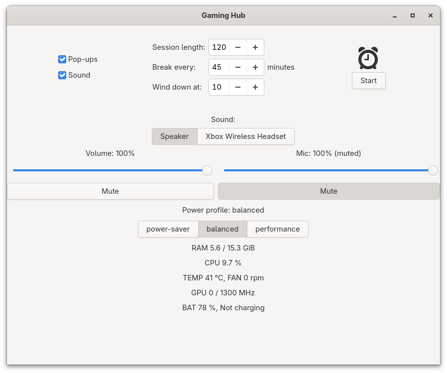

# The Sound section (milestone 6, steps 6–7)

The "Headset" section became **Sound**: the sliders control whatever I'm listening on, a row of buttons switches it, and a Bluetooth headset's battery sits beside the title. Back to the [README](../README.md).

## The rules (decided 22 Nov)

| What I'm listening on | Volume slider | Mic slider | Battery |
| --- | --- | --- | --- |
| Bluetooth headset (Xbox, JBL) | that headset | its mic (the laptop mic if it has none) | `Battery: N %` beside the title |
| Laptop speakers | the speakers | the laptop's built-in mic ("Digital Microphone") | hidden |
| HDMI to the projector | the projector's sound | the laptop mic | hidden |

Like GNOME's volume key: the sliders follow **PipeWire's default output and default input**, whatever they are. Considered and rejected: greying the sliders out on HDMI (then the hub's sound controls would be dead exactly when I play on the big screen).

## Look by hand

- **Sinks** (`pactl list sinks | grep -E 'Name:|Active Port:|available'`): the three HDMI sinks always exist, their ports say `not available` with nothing plugged in; the speakers' port is `availability unknown`, the Bluetooth sink's `available`. Rule: hide a sink only when its active port is "not available".
- **Sources** (`pactl list sources | grep -E 'Name:|Description:|device.class|api.bluez5.address|available'`): five monitors (`device.class = "monitor"`, "what's playing on that output", never a mic), `Mic2` "Stereo Microphone" (the jack, `not available`), `Mic1` "Digital Microphone" (the built-in mic), and `bluez_input.54:4C:8A:E1:83:E0` "Xbox Wireless Headset" with the same `api.bluez5.address` as its output.

## Sliders follow the default (step 6, ~0.6 h with the norm fix)

- `hub_pulse_default` passes `default_sink_name` and `default_source_name` to `hub_ask_default_sink` / `hub_ask_default_source`: each keeps a copy and asks for that device by name with the milestone 5 callbacks (`hub_sink_list`, `hub_source_list`), or greys the controls out when there is none.
- `hub_sink_list` / `hub_source_list` match **`i->name`** against the stored default name instead of the description `HUB_HEADSET_NAME` (removed). Names are unique; the Xbox's output and mic shared one description.
- Order at startup: the first lists answer before the server info, so nothing matches yet; the requests by name after it do. After a switch the old index stays until the new answer arrives; events for the old device no longer match the name.
- **Norm detour:** the BlueZ handler for `interface-proxy-properties-changed` had 6 parameters (the norm allows 4). The three BlueZ signals are now connected with `g_signal_connect_swapped` straight to `hub_bluez_show` (`hub` first, the signal's other arguments ignored), and `bluez_events.c` was deleted.

## Output buttons and the mic (step 7, ~1.8 h)

- **The row** (`outputs.c`): `hub_outputs_refresh` empties it (the first child, removed, until there is none: never ask a removed child for its sibling) and asks for every sink; `hub_outputs_list` adds a toggle button per usable sink (label: `device.profile.description`, else the description) and, when the list ends (`eol > 0`), presses the default's button. Each button keeps two owned strings: the sink's name (`HUB_PA_KEY`) and its Bluetooth address (`HUB_PA_ADDR`, `NULL` for the speakers).
- **Pressed button:** `hub_outputs_select` (handler blocked), from the end of the list and from `hub_ask_default_sink`, whichever comes last.
- **A click** (`outputs_click.c`): `pa_context_set_default_sink` with the button's name; the hub doesn't touch its own display, PipeWire's `SERVER` event updates everything. Then the mic: the button's address is copied, every source is scanned (`hub_mic_scan`: skip monitors with `monitor_of_sink != PA_INVALID_INDEX` and "not available" ports; keep the source with the same address, and the first real source without an address), and at the end of the list `hub_mic_apply` sets the default input (the headset's mic, else the laptop's) and clears both kept names. `hub_mic_keep(gchar **slot, name)` replaces an owned string in a struct field through its address.
- **Devices coming and going:** the subscription also covers cards; a sink `NEW` / `REMOVE` (a headset on / off) or a card `CHANGE` (HDMI plugged in or out) rebuilds the row. Not the frequent sink `CHANGE` (every volume move).
- **The battery line** went battery-only (`Battery: N %` / `Battery: ...`), beside the title, hidden when the output isn't a Bluetooth device; it starts hidden.
- Bugs on the way: the select walking the power row (it released the power buttons), the button row hidden instead of the battery label (no buttons at all), the power key used for the output buttons, `g_free(slot)` instead of `g_free(*slot)` (freeing a struct field's address), the laptop-mic rule keyed on the wanted address instead of the source's.
- `GLib-CRITICAL` hunting: `env G_DEBUG=fatal-criticals gdb -batch -ex run -ex bt ./gaming_hub` stops at the first critical and prints the backtrace (here: `hub_bluez_show` from `hub_bluez_ready`, writing to a removed label).

## Wrap-up (22 Nov)

`norminette` clean, no debug prints (only `g_printerr` for real errors), 0.3 % CPU at rest and ~113 MB with the Xbox on (the same as before the buttons), `make install` done. HDMI with the projector: still to test.
